

<picture>
  <source media="(prefers-color-scheme: dark)" srcset="docs/readme/hero-dark.png">
  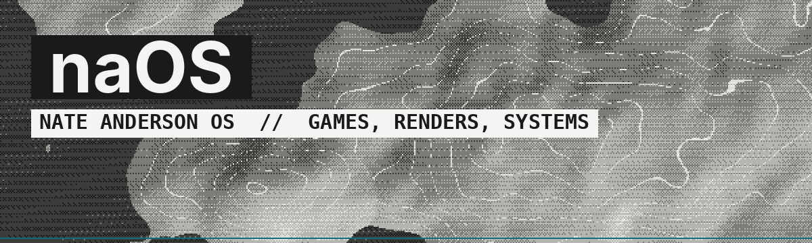
</picture>

 

 
 

Games, renders and systems, built while studying toward environmental engineering.

 

<picture>
  <source media="(prefers-color-scheme: dark)" srcset="docs/readme/divider-01.png">
  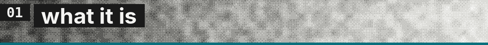
</picture>

My personal corner of the internet: a portfolio, a playground, and a running log of what I make.

The site runs on **naOS**, an original hacker-OS layer on top of **Camino**, a dark base system with one cyan accent. You get scrambling text, 1-bit dither art, scroll-linked reveals, and a command console you open with the backtick key (or Ctrl/Cmd+J). Press `?` for the shortcut sheet.

> [!NOTE]
> The site is password-gated while it is being built, so the live pages are private. This README describes what is in the repo.

<table>
  <tr>
    <td width="50%"><a href="https://nateanderson.dev">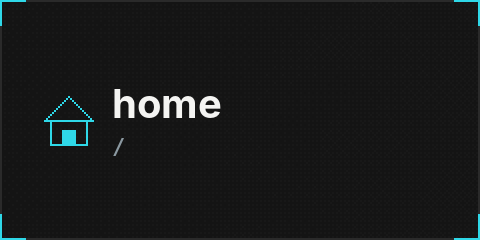</a></td>
    <td width="50%"><a href="https://nateanderson.dev/about">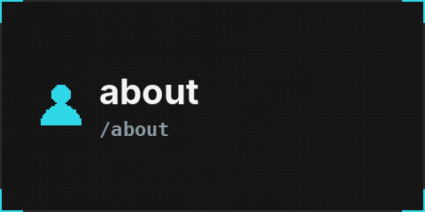</a></td>
  </tr>
  <tr>
    <td width="50%"><a href="https://nateanderson.dev/creations">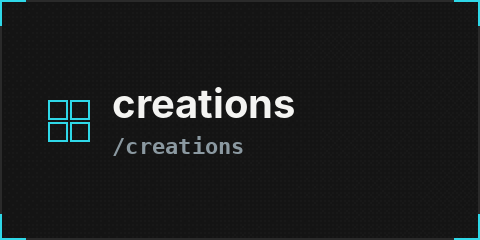</a></td>
    <td width="50%"><a href="https://nateanderson.dev/studies">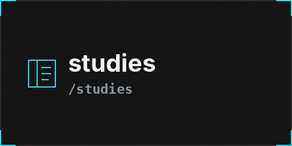</a></td>
  </tr>
  <tr>
    <td width="50%"><a href="https://nateanderson.dev/timeline">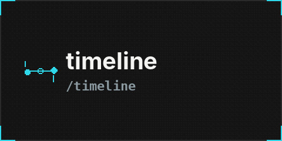</a></td>
    <td width="50%"><a href="https://nateanderson.dev/history">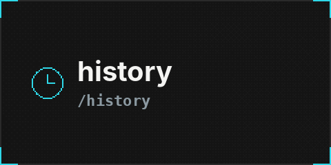</a></td>
  </tr>
  <tr>
    <td width="50%"><a href="https://nateanderson.dev/blog">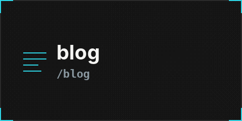</a></td>
    <td width="50%"><a href="https://nateanderson.dev">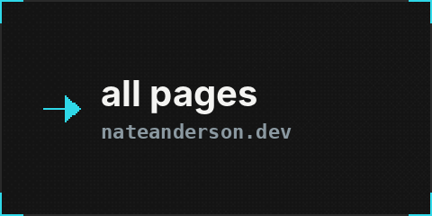</a></td>
  </tr>
</table>

 

<picture>
  <source media="(prefers-color-scheme: dark)" srcset="docs/readme/divider-02.png">
  
</picture>

Four games have their own palettes and themes. Each one runs in the browser and saves to your device.

  

**Brasswork** is a 3D voxel clockwork automation game. Place drills, kilns, windmills and belts on a brass island, research new machines, and fill the hub's orders. The palette is brass and copper, with no cyan.

  

**Starwright** is an idle star fusion game. Burn hydrogen up a ten-element ladder, go supernova, then chase neutron stars and black holes through a constellation map of 20 stars. The palette is gold, coral and magenta on violet black.

  <a href="https://nateanderson.dev/creations/games/groundbreak">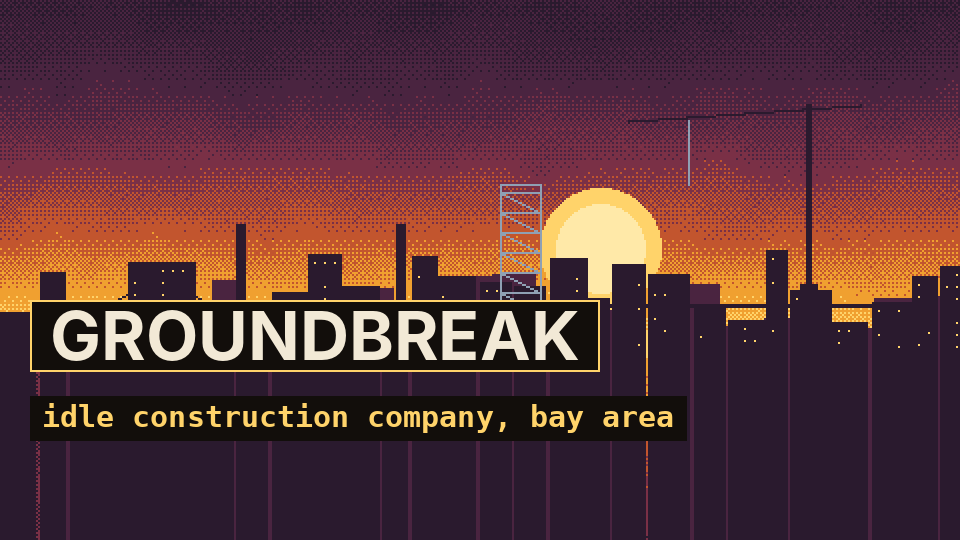</a>

**Groundbreak** is an idle construction company on a side-on Bay Area site. Unlock twelve materials in a fixed campaign of thirteen jobs, then incorporate to take the firm into the next region. The palette is golden hour: dusk purple, ember and amber.

  <a href="https://nateanderson.dev/creations/games/node-farm">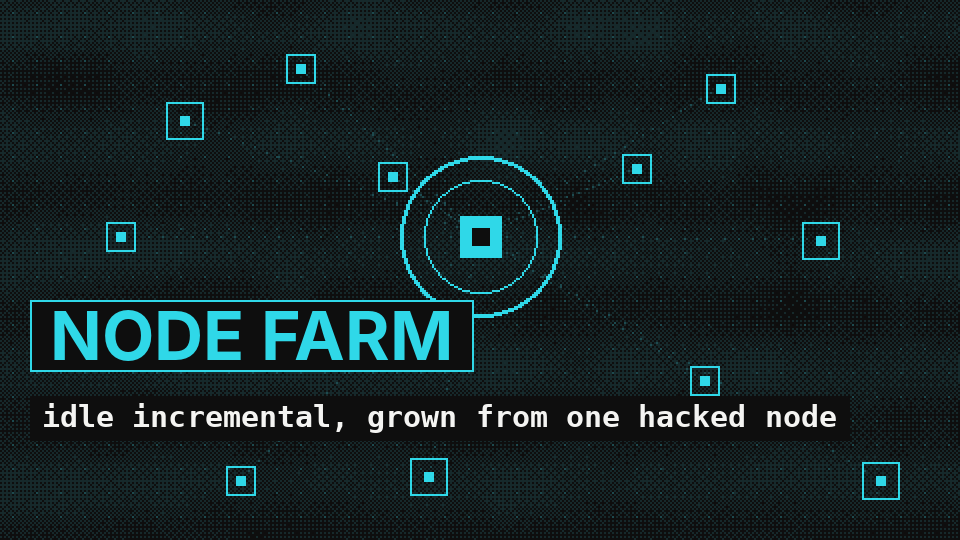</a>

**Node Farm** is an idle incremental game, grown from one hacked node in a naOS terminal. Stack stats from Bytes up to Origin, ascend for Ascension Points, and spend them on a 40-node prestige tree. The palette is cyan on near-black.

<table>
  <tr>
    <td width="50%"><a href="https://nateanderson.dev/creations/games/outline-guesser">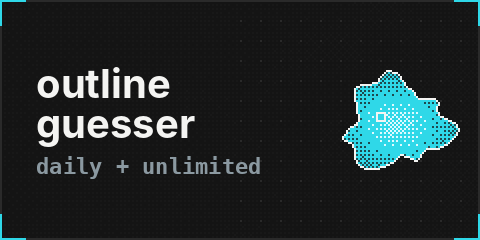</a></td>
    <td width="50%"><a href="https://nateanderson.dev/creations/games/flag-guesser">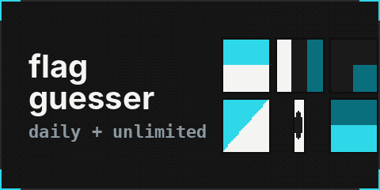</a></td>
  </tr>
</table>

 

<picture>
  <source media="(prefers-color-scheme: dark)" srcset="docs/readme/divider-03.png">
  
</picture>

  
  
  
  
  
  
  
  
  

 

<picture>
  <source media="(prefers-color-scheme: dark)" srcset="docs/readme/divider-04.png">
  
</picture>

Work lands in small pull requests against `integration`. Merging deploys nothing. `release` is the only branch Vercel builds, and it moves forward only when a deploy is asked for. See [docs/deploys.md](docs/deploys.md).

<table>
  <tr>
    <td width="50%"><a href="docs/WORKFLOW.md">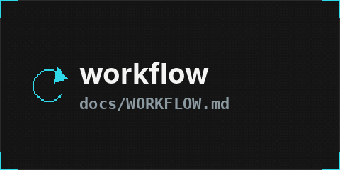</a></td>
    <td width="50%"><a href="docs/README.md">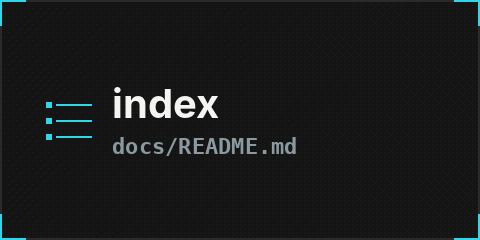</a></td>
  </tr>
  <tr>
    <td width="50%"><a href="docs/OWNERS.md">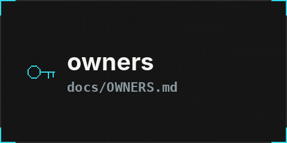</a></td>
    <td width="50%"><a href="docs/ci.md">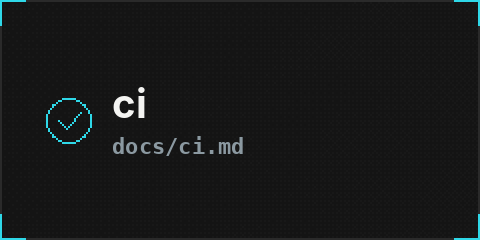</a></td>
  </tr>
  <tr>
    <td width="50%"><a href="docs/naos.md">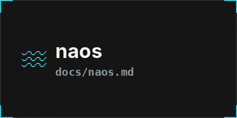</a></td>
    <td width="50%"><a href="docs/games/">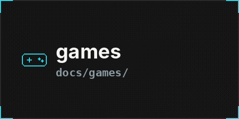</a></td>
  </tr>
  <tr>
    <td width="50%"><a href="docs/rule-changes/">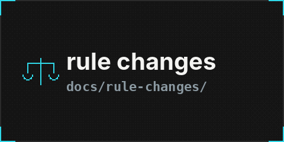</a></td>
    <td width="50%"><a href="docs/site/">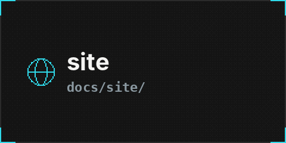</a></td>
  </tr>
</table>

 

<picture>
  <source media="(prefers-color-scheme: dark)" srcset="docs/readme/footer.png">
  
</picture>

Built by Nate. Camino base, naOS on top, one cyan accent.

