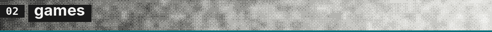
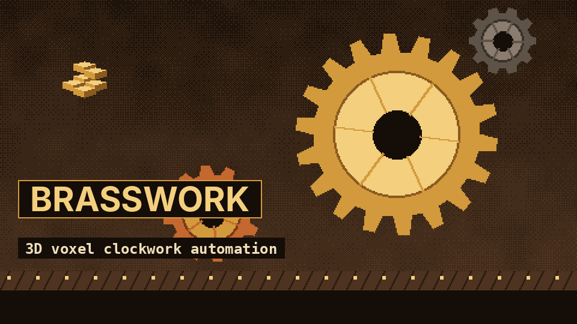
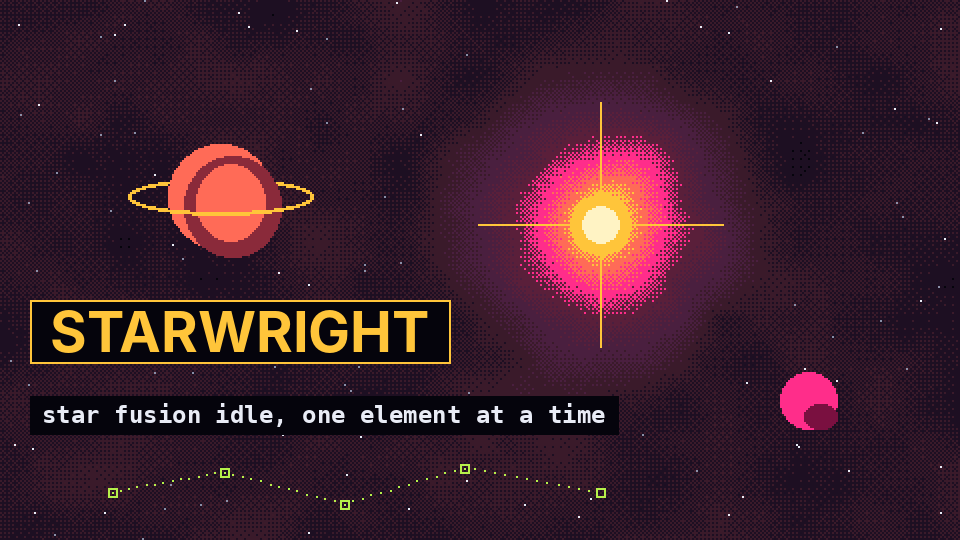
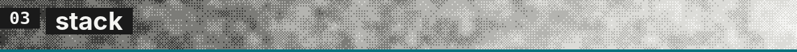
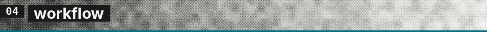
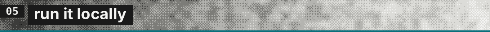
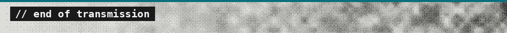

<div align="center">

<picture>
  <source media="(prefers-color-scheme: dark)" srcset="docs/readme/hero-dark.png">
  
</picture>

<br />

<a href="https://nateanderson.dev"></a>
<a href="https://nateanderson.dev/creations/games"></a>
<a href="https://nateanderson.dev/about"></a>
<a href="docs/README.md"></a>
<a href="docs/WORKFLOW.md"></a>

<br />
<br />

<sub>Games, renders and systems, built while studying toward environmental engineering.</sub>

</div>

<br />

<picture>
  <source media="(prefers-color-scheme: dark)" srcset="docs/readme/divider-01.png">
  
</picture>

My personal corner of the internet: a portfolio, a playground, and a running log of what I make.

The site runs on **naOS**, an original hacker-OS layer on top of **Camino**, a dark base system with one cyan accent. You get scrambling text, 1-bit dither art, scroll-linked reveals, and a command console you open with the backtick key (or Ctrl/Cmd+J). Press `?` for the shortcut sheet.

> [!NOTE]
> The site is password-gated while it is being built, so the live pages are private. This README describes what is in the repo.

| Page | What is there |
| :-- | :-- |
| **Home** | Intro, selected work, timeline preview |
| **About** | Stats, education timeline, skills |
| **Creations** | Games, projects, renovations and artwork |
| **Studies** | Coursework explorer and reading queue |
| **Timeline** | Milestones and the road to 2031 |
| **History** | Commit history pulled live from GitHub |
| **Blog** | Writing and updates (in progress) |

<br />

<picture>
  <source media="(prefers-color-scheme: dark)" srcset="docs/readme/divider-02.png">
  
</picture>

Four games have their own palettes and themes. Each one runs in the browser and saves to your device.

<p align="center">
  <a href="https://nateanderson.dev/creations/games/brasswork"></a>
</p>

**Brasswork** is a 3D voxel clockwork automation game. Place drills, kilns, windmills and belts on a brass island, research new machines, and fill the hub's orders. The palette is brass and copper, with no cyan.

<p align="center">
  <a href="https://nateanderson.dev/creations/games/starwright"></a>
</p>

**Starwright** is an idle star fusion game. Burn hydrogen up a ten-element ladder, go supernova, then chase neutron stars and black holes through a constellation map of 20 stars. The palette is gold, coral and magenta on violet black.

<p align="center">
  <a href="https://nateanderson.dev/creations/games/groundbreak"></a>
</p>

**Groundbreak** is an idle construction company on a side-on Bay Area site. Unlock twelve materials in a fixed campaign of thirteen jobs, then incorporate to take the firm into the next region. The palette is golden hour: dusk purple, ember and amber.

<p align="center">
  <a href="https://nateanderson.dev/creations/games/node-farm"></a>
</p>

**Node Farm** is an idle incremental game, grown from one hacked node in a naOS terminal. Stack stats from Bytes up to Origin, ascend for Ascension Points, and spend them on a 40-node prestige tree. The palette is cyan on near-black.

| Also on the site | What it is |
| :-- | :-- |
| **[Outline Guesser](https://nateanderson.dev/creations/games/outline-guesser)** | Identify a country from its outline. Daily puzzle plus unlimited practice. |
| **[Flag Guesser](https://nateanderson.dev/creations/games/flag-guesser)** | Name the country from its flag. Daily puzzle plus unlimited practice. |

<br />

<picture>
  <source media="(prefers-color-scheme: dark)" srcset="docs/readme/divider-03.png">
  
</picture>

<p align="center">
  
  
  
  
  
  
  
</p>

| Layer | What it uses |
| :-- | :-- |
| **Framework** | Next.js 16 (App Router, Turbopack), React 19, TypeScript |
| **Styling** | Camino base, the naOS layer, Tailwind CSS v4, `next-themes` for dark and paper themes |
| **3D** | Three.js 0.186 renders the Brasswork voxel island |
| **Maps and data** | `d3-geo` and `topojson-client` for the country outlines |
| **Data** | Supabase for stored project data |
| **Games** | Rules are plain TypeScript with no DOM, tested with `node:test`. Saves live in `localStorage`. |
| **Art** | Procedural 1-bit dither drawn by a script in the repo (`scripts/readme-art`), no third-party art or audio files. Sound is synthesized with Web Audio. |
| **Checks** | GitHub Actions: typecheck, production build, link crawl, Node Farm and automation test suites, and a stuck-text check |
| **Hosting** | Vercel builds one branch, `release` |

<br />

<picture>
  <source media="(prefers-color-scheme: dark)" srcset="docs/readme/divider-04.png">
  
</picture>

Work lands in small pull requests against `integration`. Merging deploys nothing. `release` is the only branch Vercel builds, and it moves forward only when a deploy is asked for. See [docs/deploys.md](docs/deploys.md).

| Doc | Read it for |
| :-- | :-- |
| [docs/WORKFLOW.md](docs/WORKFLOW.md) | How a change goes from idea to merged |
| [docs/README.md](docs/README.md) | The index of every doc in the repo |
| [docs/OWNERS.md](docs/OWNERS.md) | Which area owns which files |
| [docs/ci.md](docs/ci.md) | What each PR check runs and why |
| [docs/naos.md](docs/naos.md) | The naOS design system: tokens, art, motion, console |
| [docs/rule-changes/](docs/rule-changes/) | One file per game balance change |
| [docs/games/](docs/games/) | Per-game `FEATURES.md` and `BACKLOG.md` |
| [docs/site/](docs/site/) | Site features and backlog |

<br />

<picture>
  <source media="(prefers-color-scheme: dark)" srcset="docs/readme/divider-05.png">
  
</picture>

```bash
git clone https://github.com/FreezingShock/nateanderson-dev.git
cd nateanderson-dev
git checkout integration
npm install
```

Create `.env.local` in the project root:

```bash
NEXT_PUBLIC_SUPABASE_URL=your-supabase-url
NEXT_PUBLIC_SUPABASE_PUBLISHABLE_KEY=your-supabase-publishable-key
GITHUB_TOKEN=your-github-token   # optional, used by the History page
```

Then start the dev server and open [http://localhost:3000](http://localhost:3000):

```bash
npm run dev
```

| Command | What it does |
| :-- | :-- |
| `npm run dev` | Dev server with Turbopack |
| `npm run build` | Production build (the one to test against) |
| `npm run start` | Serve the production build |
| `npm run test:nodefarm` | Node Farm, Starwright, Groundbreak and game-shell engine tests |
| `npm run test:automation` | Brasswork simulation tests |
| `npm run format` | Format with Prettier |

Local pages sit behind the same password gate as the live site. To redraw the README art, run `python3 scripts/readme-art/generate.py`.

<br />

<picture>
  <source media="(prefers-color-scheme: dark)" srcset="docs/readme/footer.png">
  
</picture>

<div align="center">

<a href="https://github.com/FreezingShock"></a>
<a href="https://nateanderson.dev"></a>

<sub>Built by Nate. Camino base, naOS on top, one cyan accent.</sub>

</div>
